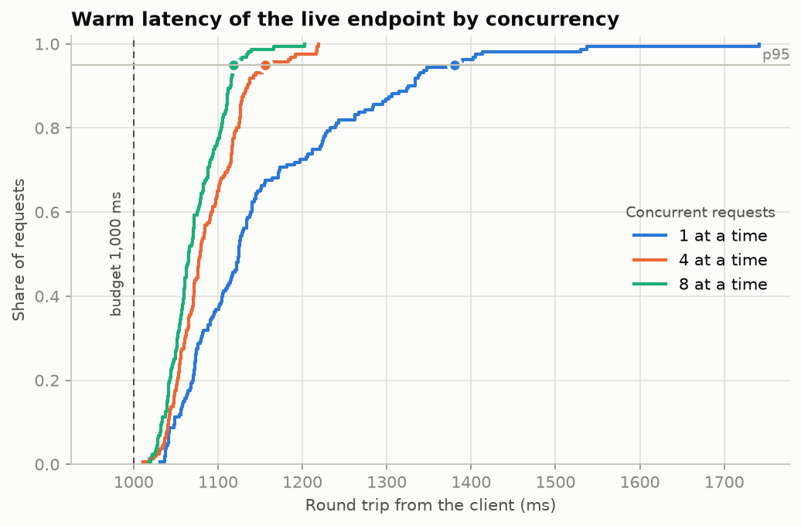

# Load test

Generated by `python -m fulfilment_optimisation.loadtest` on 2026-11-13 21:30 UTC, commit `252ddc2`, against the live function URL (image `0810a2bd704f`).

## Setup

- **Function:** 512 MB (arm64), `eu-west-2`, called from the UK over HTTPS with SigV4-signed requests and one keep-alive connection per client worker.
- **Concurrency cap:** no reserved concurrency; account limit 10 (10 unreserved). Lambda serves one request per instance, so each level stays at or under the cap.
- **Requests:** `alns` with `s_shape` routing and a 1,000 ms budget. Bodies are 30-minute arrival windows of the generator's `baseline`, `peak_day` scenarios on development seeds 0-2: 9-294 orders per request (median 65), sent in a fixed cycle.
- **Warm-up:** the first 2 requests of each worker at each level are excluded.

## Warm latency

Client = round trip measured by the load generator. Server = the app's `Server-Timing` (request arrival in the app to response ready), which excludes the network and Lambda's own routing.

| Concurrent | Requests | Throttled | Errors | Fallback | Req/s | Client p50 | Client p95 | Client p99 | Server p50 | Server p95 | Server p99 |
|---:|---:|---:|---:|---:|---:|---:|---:|---:|---:|---:|---:|
| 1 | 160 | 0 | 0 | 14% | 0.9 | 1,125 | **1,380** | 1,533 | 997 | 1,045 | 1,071 |
| 4 | 160 | 0 | 0 | 14% | 3.8 | 1,079 | **1,156** | 1,217 | 997 | 1,047 | 1,055 |
| 8 | 160 | 0 | 0 | 14% | 7.8 | 1,066 | **1,118** | 1,150 | 995 | 1,043 | 1,059 |

Times in ms. 

## By request size

All concurrency levels together. Server-side times in ms.

| Orders | Requests | Fallback | Server p50 | Server p95 | Server max | Over budget |
|---|---:|---:|---:|---:|---:|---:|
| 1-50 | 81 | 0% | 988 | 1,016 | 1,021 | 20% |
| 51-100 | 294 | 0% | 995 | 1,016 | 1,024 | 36% |
| 101-150 | 21 | 0% | 992 | 1,018 | 1,019 | 38% |
| 151-200 | 30 | 50% | 1,011 | 1,048 | 1,066 | 73% |
| 201-300 | 54 | 96% | 1,043 | 1,070 | 1,079 | 94% |

## Cold starts

No cold starts in the run's `REPORT` logs: every instance used was already warm (Lambda keeps idle instances for some minutes). See the README for single cold calls.

Peak memory used: 145 MB of 512 MB.
